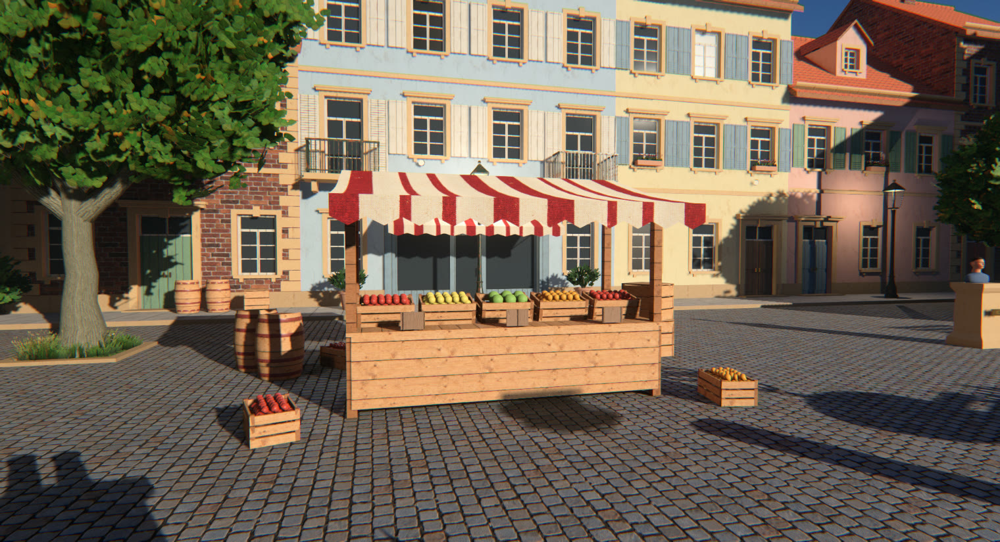

# TI Study Engine

A tech demo built to study the rendering stack Threat Interactive proposes in [Tutorial: How To
Optimize Almost Every Step In Modern Game Rendering][video] (2026-08-01), and to assess how it
performs, looks and feels in practice. It implements the video's pipeline in a small Direct3D 11
renderer, renders a purpose-built test scene with it, and measures each technique against what it
replaces: [docs/PERF.md](docs/PERF.md) tests TI's claims one by one, and the technique docs record
what was built, what it costs and where it deviates.

**Fully AI-written.** An AI, Anthropic's Claude (Opus 5.5, in Claude Code), wrote everything in
this repository, starting from the roughly two-hour video: the research notes, the C++ and HLSL,
the Blender scripts that build the scene, the texture pipeline, the benchmarks and these docs. It
digested the video, researched the techniques it cites, then implemented and measured them. The
textures come from Gemini image models. A human set the goals and made the calls along the way.

It is a study, not a product. The code is meant to be readable rather than general: plain structs
and functions, one file per pipeline stage, comments that explain each technique and cite where it
comes from, and an A/B toggle next to almost every technique. It could serve as the base of a real
engine, but it has no editor, asset pipeline or platform layer beyond what the study needed, and all
numbers come from one machine.

- Windows + Direct3D 11 only (feature level 11.0/11.1, Shader Model 5.0), no vendor SDKs.
- Dependencies: `windows.h`/the Windows SDK. Everything else is vendored in `third_party/`
  (Dear ImGui, cgltf, meshoptimizer, stb_image, SMAA) or hand-rolled (math, JSON, renderer).
- Demo scene built procedurally in Blender (through the Blender MCP), textures generated with
  Gemini 3 Pro Image where procedural generation wasn't good enough (see `assets/README.md`).



Default frame on an RTX 5060 at 1920x1080, 2x MSAA + SMAA 4x, everything on: 2.5-6.9 ms per
viewpoint, 4.3 ms on average at stock clocks; 4.1-12.0 ms (7.4 ms average) with the clock locked at
1485 MHz, about the shader throughput of the RTX 3060 TI's budgets are for. Later shadow work
brought the locked average to ~6.8 ms. Results and TI's claims tested: [docs/PERF.md](docs/PERF.md).
The test card is suspected of PCIe flakiness (two driver crashes during development, one a bus
reset), so read the benchmarks as indicative; see PERF.md.

[video]: https://www.youtube.com/watch?v=SnNm7rSSvlg

## Build and run

Open `engine.slnx` in Visual Studio 2026 (toolset v145) and build `Release|x64`, or:

```bash
"/c/Program Files/Microsoft Visual Studio/18/Community/MSBuild/Current/Bin/amd64/MSBuild.exe" engine.vcxproj -p:Configuration=Release -p:Platform=x64 -p:SolutionDir=$(pwd)/ -m
```

```bash
build/bin/Release/ti_engine.exe
```

Shaders are compiled at startup from `shaders/` (F5 recompiles them). The default scene is
`assets/scene/courtyard.gltf`; without it, a small procedural test scene is used.

The textures ship as PNG (lossless sources, ~65 MB). The engine builds their mips on the CPU at load
(about 3 s). For the BC7 set the benchmarks used (~0.4 s loads, a quarter of the GPU memory), put
`texconv.exe` from [DirectXTex](https://github.com/microsoft/DirectXTex/releases) in
`.tools/texconv/` and run:

```bash
python -I tools/textures/compress_bc.py assets/scene/courtyard.gltf
```

It writes `assets/scene/dds/*.dds`, which the engine then prefers (`--no-bc` forces the PNGs).

Command line options:

| option | meaning |
|---|---|
| `--scene file.gltf` / `--test-scene` | scene to load |
| `--msaa N`, `--res WxH` | MSAA sample count (1, 2, 4), internal render resolution |
| `--viewpoint NAME` | start at a named viewpoint from `bench_path.json` |
| `--bench NAME` | run a benchmark and exit (`all`, `prepass`, `order`, `clears`, `lights`, `msaa`, `depth`, `aa`, `shadows`, `localshadows`, `gi`, `post`, `motionblur`, `sss`, `vfx`, `lod`, `smoke`); results in `bench/`, each with a per-pass table against TI's budgets |
| `--debug` | D3D11 debug layer, messages in `build/engine.log` |
| `--view N`, `--no-ui`, `--screenshot out.png --frames N`, `--profile-dump out.csv` | scripted captures and timings |
| `--stats` | D3D11 pipeline statistics (pixel shader invocations) per pass, in the profiler and the profile dump |
| `--no-animate`, `--time T`, `--no-unjitter` | freeze time (temporal stability tests); freeze it at T seconds (the wind phase in screenshots); disable texture/lighting jitter compensation |
| `--no-wind`, `--exposure EV` | wind sway off; fixed exposure (auto exposure off), for comparable screenshots together with `--no-awb` and `--no-animate` |
| `--no-bc`, `--no-mesh-opt` | load the PNG textures instead of BC7, skip meshoptimizer triangle reordering (load-time A/Bs) |
| `--camera px,py,pz,tx,ty,tz`, `--sun ELEVATION,AZIMUTH` | camera position and target, sun direction in degrees (reproducible captures) |
| `--tonemapper N`, `--tonemap-alu`, `--no-bloom`, `--no-awb` | tone mapper (0 = GT7 ... 6 = AgX), evaluate the curve per sample instead of the LUT, bloom off, auto white balance off |
| `--gi 0\|1`, `--gi-spacing M`, `--gi-max-probes N`, `--gi-visibility 0\|1`, `--gi-relight-every-frame`, `--ao off\|full\|half` | probe-grid GI and GTAO switches |
| `--shadow key=value` | shadow A/Bs: `local=fitted\|fixed\|off`, `fixed_res=N`, `max_res=N`, `density=F`, `atlas=N`, `depth=16\|32`, `pcf=4\|9`, `slice_cull=0\|1`, `amortize=0\|1`, `foliage_cards=0\|1`, `foliage_distance=M`, `sun=intensity`, `far_clip=0\|1\|2`, `fade_px=F`, `cache=0\|1`, `dynamic_interval=N` |

Only one engine instance runs at a time (a named mutex): several instances hammering the GPU at
once crashed the display driver during development, and they would spoil each other's timings.

Tools: `tools/perf_report.py` (benchmark CSVs to markdown tables), `tools/frame_diff.py`
(frame-to-frame difference of two screenshots: temporal stability), `tools/textures/compress_bc.py`
(BC7 DDS versions of a glTF's textures with texconv).

Controls: right mouse + WASD/QE to fly (Shift faster, Ctrl slower), F1 toggles the UI, F5 reloads
shaders, F12 saves a screenshot. The UI exposes every technique toggle, the debug views (G-buffer
channels, stencil shading models, MSAA edges, quad overdraw, shadow cascades...), viewpoints and the
benchmarks, and a GPU profiler with per-pass timings.

## Documentation

- [docs/PIPELINE.md](docs/PIPELINE.md): the frame, pass by pass, as implemented, mapped to the video.
- [docs/PERF.md](docs/PERF.md): methodology and measured results on the test machine (RTX 5060, Ryzen 9 5900X),
  each of TI's claims with its test and verdict; every table in [docs/perf-tables.md](docs/perf-tables.md).
- [docs/techniques/](docs/techniques/): each technique as implemented, with costs and deviations.
- [docs/research/](docs/research/): the research notes the implementation is based on (sources,
  formulas, published numbers), including a transcription of the video's pipeline chart.

## Code layout

| path | what |
|---|---|
| `src/main.cpp`, `src/app.*`, `src/ui.cpp` | window, loop, input, command line, ImGui panels and styling |
| `src/gpu.*` | D3D11 device, textures/buffers/shaders helpers, runtime shader compilation, GPU timestamp profiler |
| `src/scene.*` | glTF loading (cgltf), CPU mip generation, meshoptimizer triangle reordering + LODs, test scene |
| `src/renderer.*`, `src/renderer_internal.h` | settings, the render targets, the frame graph (`renderer_frame`) |
| `src/r_geometry.cpp` | culling, LOD, sorting/instancing, clears, depth pre-pass, base pass, MSAA edge stencil |
| `src/r_shadows.cpp`, `src/r_local_shadows.cpp` | sun cascades; density-synced local-light shadow projectors in one atlas |
| `src/r_sky.cpp` | atmosphere LUTs (Hillaire 2020) and the sky ambient cube |
| `src/r_gi.cpp`, `src/r_gtao.cpp` | baked irradiance probe grid (capture, relight); GTAO |
| `src/r_lighting.cpp` | sun + ambient, stencil-volume local lights, composition with fog, sky |
| `src/r_sss.cpp` | screen-space subsurface scattering |
| `src/r_vfx.cpp` | glass, half-resolution particles |
| `src/r_post.cpp` | exposure and white balance, tone mapping, SMAA, temporal resolve, final output, debug views |
| `src/r_bloom.cpp`, `src/r_tonemap_lut.cpp` | CoD:AW bloom; the GT7 tone-curve LUT |
| `src/r_motion.cpp` | motion blur |
| `src/bench.cpp` | the benchmark harness |
| `shaders/` | HLSL, one file per pass family; `common.hlsli` has the shared constant buffers and stencil layout |
| `tools/` | benchmark report, frame diff, texture pipeline (`textures/`), Gemini image tool (`imagegen/`) |

## License

MIT, see [LICENSE](LICENSE); this covers the code, shaders, tools, docs and the demo assets. The
vendored libraries in `third_party/` keep their own (MIT-style) licenses:
[THIRD_PARTY_NOTICES.md](THIRD_PARTY_NOTICES.md).
