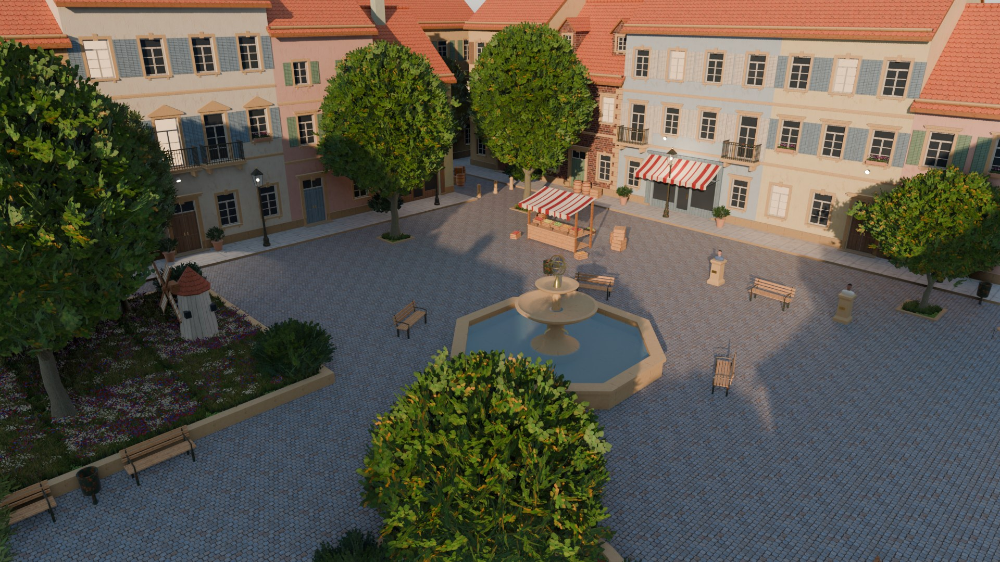

# Courtyard test scene

A small European town square at golden hour (~60 m x 60 m, meters, glTF +Y up) built to exercise
every technique of the renderer: large close occluders for the depth prepass, ~320 k alpha-tested
foliage cards for prepass / base-pass ordering, a dual-profile painted-iron material, skin busts for
screen-space SSS, glass (alpha blend), emissive signage, 16 punctual lights, procedurally animated
objects, VFX emitter markers and projected decals.



| File | What |
|---|---|
| `scene/courtyard.gltf` + `.bin` | The scene (glTF 2.0 separate, no compression) |
| `scene/textures/*.png` | 40 textures referenced by the glTF (processed, tileable) |
| `scene/bench_path.json` | 40 s benchmark fly-through + 8 static viewpoints (glTF coordinates) |
| `previews/preview_*.jpg` | EEVEE reference renders (overview, street level, bust close-up) |
| `blender/courtyard.blend` | Source scene (Blender 5.1). `courtyard.blend1` is Blender's auto backup and can be ignored |
| `blender/scripts/*.py` | Scripts that build the whole scene from scratch, export and verify it |
| `source_textures/*_src.png` | Raw Gemini generations (inputs of the texture pipeline) |
| `../tools/textures/*.py` | Texture pipeline (numpy + Pillow) |

## Layout (Blender frame: X east, Y north, Z up; glTF = (X, Z, -Y))

- Square: cobbles over x in [-19.5, 19.5], y in [-17.5, 17.5]; raised (12 cm) paved sidewalks with
  curbs in front of four rows of 2-3 storey houses (fronts at x = +-22, y = +-20). Streets leave the
  square in the NE (closed by a house at y = 29) and the SW (two background rows). A bell tower
  (~38 m, gilded orb and cross, clock faces) stands behind the north row.
- Park bed in the NW quadrant (x -17..-5, y 3..15, 32 cm stone curb): lawn, 3 trees, bushes,
  9 instanced grass/flower tiles, a garden windmill. Round flower bed with a small tree at (-8, -8).
- Fountain at (2, -1): octagonal basin with water, two-bowl column, gilded armillary sphere.
- Market stall (12, 7.5) with produce crates, cafe terrace in front of Bldg_S1 (x 12..22, y -20)
  with a see-through shop window, lit interior and a pink/cyan neon "CAFE" sign, an arcade
  (portico with 3 arches, Bldg_S2) and an archway passage closed by a gate (Bldg_S3).
- Two busts on pedestals at (12.9, -1.6) and (12.9, -7.4), facing west towards the low sun.
- Sun from azimuth 240 deg (WSW), elevation 17 deg: the west half of the square is in long building
  shadows, east/north facades are lit, light streams in through the SW street.

## Contents

| Group | Objects |
|---|---|
| Buildings | 25 row/background houses + 2 corner fillers + church tower. Plaster (7 tints) or brick walls, recessed windows (22 cm reveals), stone surrounds/sills/pediments, louvred shutters, balconies with iron railings, string courses, cornices, quoins, gable roofs with ridge tiles, dormers, chimneys with pots, doors with transoms, shopfronts with striped awnings. Windows/doors/shopfronts are separate instanced modules (`Building_Modules`, 198 nodes / 45 meshes). |
| Ground | `Ground_Cobble`, `Ground_Sidewalks` (incl. curbs), `Ground_Outer`, `Ground_Lawn`, `Ground_Arcade_Floors`, `Tree_Pits` (all `no_shadow`), `Park_Curbs` (casts shadows). |
| Foliage | 27 trees from 4 meshes (linden x2 seeds 27.6 k tris / 13 000 cards each, narrow 16.3 k / 7 500, small 13.2 k / 6 000): 11 in/around the square, 16 in the back yards (visible above the roofs). 12 bushes, 7 potted shrubs, 26 window flower boxes, 3 ivy walls (3 400-3 600 cards each), 9 grass tiles (3 000 crossed cards each, 2 variants), a round flower bed (2 700 cards), 6 tree-pit grass tufts. About 322 k alpha-tested cards in total (instanced). |
| Props | 8 street lamps, 8 benches, fountain, market stall, crates/barrels/produce crates, 5 bistro tables + 13 chairs, 2 parasols, bottles (glass, alpha blend), wine glasses, fire barrel, bollards, bins, terracotta pots, wall spot housings, neon sign, inn sign bracket, garden windmill tower. |
| Busts | `Bust_A_*` (light skin) / `Bust_B_*` (dark skin): procedural human head (lofted slices + analytic features, eyelids wrapping the eyeballs, ~76 k tris each), separate eyeballs (shading model `eye`), cloth drape, stone pedestal. |
| Lights | Sun, 8 lamp points, 4 wall spots, cafe interior, neon glow, fire barrel (see below). |

## Conventions

### Export
`blender/scripts/export.py`: GLTF_SEPARATE, +Y up, apply modifiers, normals + tangents + UVs,
materials, custom properties as extras, KHR_lights_punctual, no cameras, no animations, no
Draco/meshopt, textures referenced in place (`textures/*.png`, `export_keep_originals`). All
n-gons are triangulated at build time so every primitive has TANGENT. Shared meshes (linked
duplicates) are exported once and referenced by several nodes; such instances carry their rotation
/ uniform scale in the node, unique meshes have rotation and scale baked in.

### Materials (material extras)
Principled BSDF setups the exporter understands: Base Color texture (sRGB, optional Mix-Multiply
tint -> `baseColorFactor`), ORM texture (R = occlusion via the `glTF Material Output` group,
G = roughness, B = metallic) written once as `occlusionTexture` + `metallicRoughnessTexture`,
tangent-space normal maps (OpenGL / glTF +Y convention).

- `shading_model`: `default` (37), `emissive` (5: lit windows, lamp bulbs, embers, 2 neons),
  `glass` (4: clear glass, green/amber bottle glass, water - all `alphaMode` BLEND, alpha in
  `baseColorFactor.a`), `foliage` (2: `leaves`, `grass_cards` - `alphaMode` MASK, cutoff 0.5 =
  glTF default, double sided), `skin` (2), `eye` (1).
- `profile`: plaster, brick, stone, ceramic (roof tiles, terracotta), wood, cloth, paint_iron,
  iron, gold, glass, foliage, bark, skin, plus two names not in the suggested list: `ground`
  (lawn soil/grass ground) and `eye`.
- `paint_iron` (`paint_iron_green`, `paint_iron_red`: lamp posts, railings, bench frames, bins,
  barrel hoops, fire barrel): the METALLIC (B) channel of `paint_iron_orm.png` is the blend mask,
  0 = paint, 1 = bare iron / rust. The albedo already contains paint vs. rust per the same mask.
- Ordinary window panes are opaque (`window_dark`, profile glass, shading default). Transparent
  glass: the cafe shop window (with an interior behind it), the lantern panes, bottles, glasses.
- `skin_dark` reuses the skin textures with a `baseColorFactor` tint. Skin UVs are a cylindrical
  projection painted to match the head geometry (lips, brows, cheeks, hairline).
- Blender-only: skin materials have a little Principled subsurface for the EEVEE previews; it is
  not exported.

### Node extras
| Key | Value | On |
|---|---|---|
| `no_shadow` | 1 | ground/floor meshes (6 nodes) - never cast shadows |
| `wind` | 1 | 91 nodes: trees, bushes, potted shrubs, ivy, grass tiles, flower bed, flower boxes. A flag: the engine bends each with the square of its height, its top by at most 25 cm (`wind_bend()` in `src/scene.cpp`) |
| `anim` | `rotate` | `Windmill_Sails`: `anim_axis` [1,0,0], `anim_speed` 1.3 rad/s, pivot = node origin (hub) |
| `anim` | `swing` | `Inn_Sign`: `anim_speed` 1.7 rad/s, `anim_amp` 0.14 rad, pivot = node origin (hinge under the bracket arm); extra `anim_axis` [1,0,0] = swing axis |
| `anim` | `slide` | `Cart`: `anim_axis` [1,0,0] (world, unit), `anim_amp` 9 m, `anim_speed` 0.25 rad/s; suggested `pos = rest + axis * amp * sin(speed * t)` keeps it on its track (glTF x = -12 .. 6 at z = 13.6) |
| `vfx` | `smoke` / `fire` / `spray` | 11 empties: 7 chimney smokes + 1 over the fire barrel, `VFX_Fire_Barrel`, 2 fountain sprays |
| `decal` | `stain` / `moss` / `cracks` | 14 empties, plus `opacity` 0.6-1.0 (see below) |
| `shadow` | 1 / 0 | every light node (also in the light's own extras) |
| `kind` | `building` | informational, on the 28 building shells |

The three animated nodes have identity rotation, so local and world axes coincide; axes are given in
glTF space.

### Decals
Empties `Decal_*` (collection `Decals`): projection box = [-0.5, 0.5]^3 in node space scaled by the
node scale, projected along the node's local +Y (glTF). Ground decals have identity rotation (scale
X/Z = footprint, Y = 0.3-0.5 m depth); the two wall decals (`Decal_Moss_Wall_W3`,
`Decal_Cracks_Wall_S4`) are rotated so local +Y points out of the wall. 5 stains (market stall,
cart track, soot under the fire barrel), 5 moss (fountain foot, park curb, damp brick wall base),
4 cracks (north/east sidewalk, arcade floor, plaster facade).

### Lights (KHR_lights_punctual, exporter "Standard" units)
| Light | Type | Blender | glTF intensity | range | shadow |
|---|---|---|---|---|---|
| `Light_Sun` | directional | 5.5 W/m2, color (1, .68, .42), az 240 / el 17 deg | 3757 lx | - | 1 |
| `Light_Lamp_01..08` | point at the lantern bulbs | 120 W, (1, .70, .42) | 6522 cd | 10 m | 1 on 02, 05, 07, 08 |
| `Light_Spot_Arcade/Market/Busts/Entrance` | spot (wall/ceiling mounted) | 350-600 W, cone 34-70 deg | 16-33 k cd | 16 m | 1 |
| `Light_Cafe_Interior`, `Light_Neon_Glow`, `Light_Fire_Barrel` | point | 80 / 25 / 60 W | 4348 / 1359 / 3261 cd | 6 / 4 / 6 m | 0 |

Intensities are consistent with each other (W -> lm with 683 lm/W); rescale globally in-engine.
Note: Blender 5.x lights always carry a node tree and the exporter reads colour (and the sun's
strength) from its Emission node, so `lights.py` mirrors colour/energy into that node.

### bench_path.json
`{"duration": 40, "coordinate_system": ..., "keys": [{"t", "pos", "target", "note"}], "viewpoints": [{"name", "pos", "target"}]}`
in glTF coordinates. Path: overview from the SW (0 s) -> descend -> round flower bed (7 s) ->
walk through the park grass under the trees past the windmill (10-19 s) -> busts close-ups
(25-29.5 s) -> fast 180 deg turn in 0.8 s (30.5-31.3 s) -> street lamps into the low sun (33.5 s)
-> the moving cart (36.5 s) -> into the arcade (40 s). Viewpoints: `square_overview`,
`foliage_dense`, `busts_closeup`, `lamps`, `arcade`, `skyline`, `cafe_neon`, `market`.
`keys` are sparse; interpolate (e.g. Catmull-Rom) between them.

## Counts (from `verify_gltf.py`)

| | |
|---|---|
| Triangles rendered (instancing expanded) | **1 006 671** (unique mesh data 367 815) |
| Nodes | 487 (446 mesh nodes, 16 lights, 11 VFX, 14 decals) |
| Meshes / primitives | 128 / 475 |
| Draw items (primitives x mesh instances) | 1 369 |
| Materials / images | 51 / 40 PNG (80 glTF texture entries) |
| Alpha modes | 45 OPAQUE, 4 BLEND, 2 MASK |
| By group (tris) | foliage 689 k, busts 169 k, window/door modules 71 k, props 54 k, buildings 20 k, animated 4 k, ground 1 k |

## Textures

40 PNGs in `scene/textures/` (1024^2 unless noted):

| Set | Files | Source |
|---|---|---|
| brick, stone, wood, roof | albedo, normal, orm | Gemini |
| cobble (2048^2) | albedo, normal, orm | Gemini |
| plaster, paving, grass, paintedwood, bark, cloth | albedo, normal | Gemini (constant roughness factor) |
| paint_iron | green/red albedo, normal, orm (B = paint/rust mask) | Gemini paint + rust, procedural mask |
| leaf_atlas | albedo (RGBA), normal | procedural, 2x2 cells: broad, broad-autumn, small (bush/ivy), narrow |
| grass_atlas | albedo (RGBA) | procedural, 2x2 cells: lawn, wild grass + seed heads, daisies, poppies/cornflowers |
| skin | albedo, normal, orm | procedural, painted for the head UVs |
| eye (512x256) | albedo | procedural (iris at the front pole) |
| brass (512^2) | albedo, orm | procedural (gold profile) |

Tiling (meters per texture repeat, see `TILE` in `common.py`): brick 2.5, plaster 3, stone 2,
cobble 2.2, paving 3, grass 3, wood 1.2, paintedwood 1.2, bark 1.4, roof 2.4, cloth 2, paint_iron 1.

### Photographic sources (Gemini 3 Pro Image via `tools/imagegen/gen.py`, 2K)
Every prompt is `<subject> + " Seamless tileable texture, top-down orthographic view, flat even
diffuse lighting, no shadows, no highlights, no perspective, no vignette, albedo color map only,
photographic, high detail, fills the whole frame edge to edge, no text, no watermark."`; subjects
(verbatim in `tools/textures/gen_sources.py`):

- brick: Old European red clay brick wall in running bond, about 8 bricks across and 22 courses tall, bricks with natural variation from dark red to orange-brown and a few darker burnt bricks, recessed light grey lime mortar joints, slightly weathered.
- plaster: Off-white lime plaster stucco wall surface, subtle trowel texture and fine sand grain, very faint patchy discoloration and light weathering stains, uniform overall brightness.
- stone: Smooth honey-beige limestone surface (dressed building stone), fine grain with tiny pores, subtle weathering, no block joints, uniform overall brightness.
- cobble: Old European cobblestone street pavement seen from directly above, square granite setts in straight rows, each stone about 10 cm, grey with warm brown and bluish tones, rounded worn tops, dark sandy gaps between stones, about 20 stones across.
- paving: Sidewalk made of large rectangular light grey sandstone paving slabs in straight courses, about 4 slabs across, thin dark joints, subtle stains and wear.
- grass: Short lawn grass seen from directly above, dense green blades with natural color variation, some dry yellowish blades, a few clover leaves and tiny bits of brown soil showing through, irregular and natural, evenly distributed. (`grass_src_v1_dots.png` is a rejected first attempt with polka-dot soil patches.)
- wood: Weathered natural pine wooden planks running horizontally, about 6 planks across the height, visible grain and knots, thin dark gaps between planks, warm light brown.
- paintedwood: Old wooden boards painted in off-white paint, boards running vertically, about 6 boards across, slightly worn paint showing a little wood grain, thin gaps between boards, uniform brightness.
- bark: Bark of a mature linden tree, vertical furrows and ridges running vertically, grey-brown with a subtle moss-green tint, uniform brightness.
- rust: Heavily rusted bare iron surface, orange-brown and dark brown rust with pitting and flaking, uniform distribution.
- paint_green: Painted iron surface with dark bottle-green enamel paint, slightly worn with fine scratches and subtle brush marks, no rust, uniform color.
- paint_red: Painted steel surface with oxblood red enamel paint, slightly worn and faded with fine scratches, no rust, uniform color.
- roof: Terracotta clay roof tiles (flat beaver-tail tiles) in overlapping rows, orange-red with color variation and slight dark weathering, a few lichen spots, rows horizontal, about 8 tiles across.
- cloth: Woven canvas awning fabric with wide vertical stripes alternating deep red and cream, visible weave texture, slightly faded, 4 stripe pairs across.

Plaster, paintedwood and stone are near-neutral on purpose: per-material tints are applied with
`baseColorFactor` (7 plaster colours, 5 shutter/door paints, stone/grey stone, dark wood).

### Processing (`tools/textures/process_photo.py`, helpers in `texlib.py`)
1. Lanczos resize to the target size, remove low-frequency lighting gradients
   (divide by blurred luminance).
2. Make tileable: half offset + two minimum-error boundary cuts per axis (image-quilting style,
   2-3 px feather), so bricks and tiles don't ghost the way a cross-fade would.
3. Height per material recipe (luminance, inverted luminance or saturation for brick mortar,
   multi-scale blur, smoothstep "domes" for setts) -> wrap-around Sobel normal map in the OpenGL /
   glTF convention (+Y = up in the image), AO from multi-radius cavity, roughness from height /
   noise. ORM = (AO, roughness, metallic).
4. paint_iron: domain-warped fBm blotches + pitting + periodic scratches -> mask; albedo =
   lerp(paint, rust, mask) with rust staining bleeding into nearby paint; height = paint film
   above the corroded iron; mask written to the B channel.

Procedural textures (`tools/textures/procedural.py`): leaf/grass atlases drawn as antialiased
vector shapes at 4x, colour dilated into transparent texels with a push-pull fill (no dark
mip fringes); skin = tone + mottling + painted features + pores normal; eye; brass.
`tools/textures/contact_sheet.py` makes review sheets (`--tile 2` shows seams).

## Regenerating

```sh
# 1. source albedos (skips existing files; --force NAME to redo one; retries on HTTP 429)
python -I tools/textures/gen_sources.py
# 2. scene textures
uv run -q --with numpy --with pillow python -I tools/textures/process_photo.py
uv run -q --with numpy --with pillow python -I tools/textures/procedural.py
# 3. scene: build from scratch, save courtyard.blend, write bench_path.json, export the glTF
#    (in Blender 5.1, e.g. Scripting tab or the MCP execute tool)
import sys; sys.path.insert(0, r"<repository>\assets\blender\scripts")
import build_scene; build_scene.main(save=True, export=True)
# 4. check conventions + counts
python -I assets/blender/scripts/verify_gltf.py assets/scene/courtyard.gltf
```

Scripts (`assets/blender/scripts/`): `common.py` (MeshBuilder, box/lathe/tube/sweep primitives,
metric UVs, instancing), `materials.py` (all material specs), `buildings.py`, `ground.py`,
`props.py`, `foliage.py`, `busts.py`, `lights.py`, `decals.py`, `preview.py` (sky, EEVEE settings,
cameras - previews are rendered with `preview.render`), `bench_path.py`, `export.py`,
`verify_gltf.py` (plain Python), `build_scene.py` (orchestration). Everything is deterministic
(seeded RNG); a full rebuild + export takes ~4 s.

## Known limitations

- The busts are stylised (mannequin-like) procedural heads, not sculpted portraits; hair is
  painted into the skin texture (short crop). The bust preview was rendered with the final
  geometry.
- Roof tiles, cobbles and bricks are flat surfaces with normal maps (no per-tile geometry).
- Lit windows are emissive planes; only the cafe has a real interior.
- Foliage normals are the geometric card normals (spec-compliant double-sided flipping).
